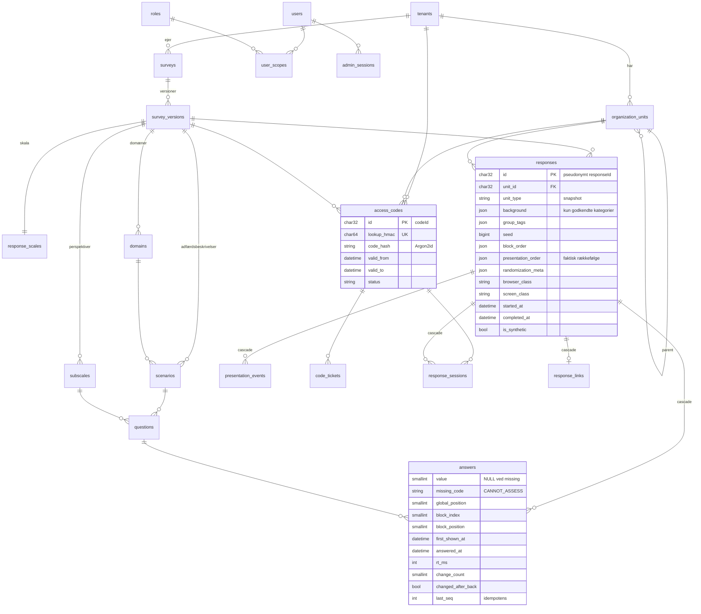

# Datamodel

Fire databaser. Pile mellem databaser er fremmednøgler; `qa_data` har bevidst **ingen** reference til
`access_codes` eller brugere (kun `imported_by`/`published_by` som ikke-FK id'er), så analysedata kan
udleveres uden identitets-/adgangsdata.

Øvrige tabeller: `qa_identity.rate_limits` (pseudonymiseret bucket, udløb), `qa_analysis.analysis_runs`
(filtre, parametre, tilladte afdelinger, resultat, softwareversioner, datahash),
`qa_audit.audit_events` (hash-kæde: `prev_hash`, `hash`).

## Personlige adgangskoder

Alle adgangskoder er personlige: højst én besvarelse ad gangen pr. kode. Koblingen kode → besvarelse
findes kun i `qa_identity.response_links` (ikke i analysedata) og udløber med opbevaringsperioden.
Deltageren logger ind igen med koden for at fortsætte en påbegyndt besvarelse eller for at trække en
besvarelse tilbage (den slettes helt, auditeres som `respondent.withdrawn`) og derefter svare forfra.
Koden virker også på siden om rettigheder (indsigt/sletning), også efter at koden er udløbet. Koderne
udleveres som PDF (`POST /api/admin/access-codes/personal-pdf`): én forside til den ansvarlige pr.
afdeling og én side pr. kode med vejledning og QR-kode (`/#kode=…`; fragmentet sendes ikke til serveren).
Klartekst gemmes ikke.

## Missing-koder i analysedata
| Kode | Betydning |
|---|---|
| `CANNOT_ASSESS` | Respondenten valgte "Kan ikke vurdere" |
| `NOT_ANSWERED` | Vist (`first_shown_at` sat), men ikke besvaret |
| `NOT_REACHED` | Aldrig vist (besvarelsen stoppede før) |
